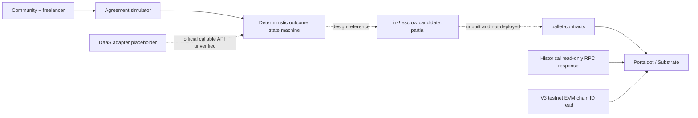

# TrustFall Architecture

## Boundary

- `dist/simulator.js` is the tested source of truth for the public simulator.
- The browser demo never requests a wallet, seed, private key, or real funds.
- `contracts/trustfall` is a partial compatibility candidate, not a complete implementation of the simulator. It has not been built, tested, or deployed in this review.
- `scripts/rpc-smoke.mjs` performs read-only JSON-RPC calls and saves evidence.
- A production design would add a verified stablecoin asset, contract events, wallet signing, mediator governance, timeout enforcement, and audited upgrade controls.

